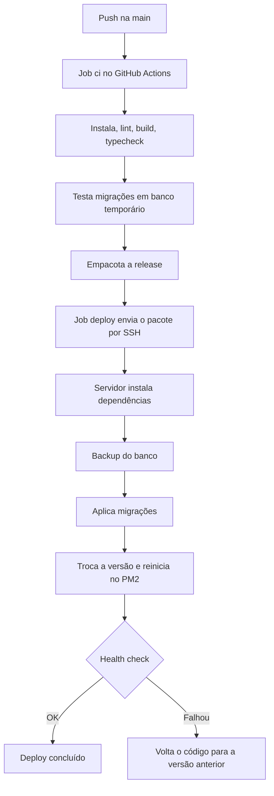

# CI/CD: como funciona e como configurar

Este guia explica como o código sai do GitHub e chega ao servidor de produção, e como configurar o acesso entre os dois. Para comandos do dia a dia no servidor, veja também [deploy/README.md](../deploy/README.md).

## Visão geral

Todo push na branch `main` dispara o workflow [`.github/workflows/deploy.yml`](../.github/workflows/deploy.yml). O código só é publicado se todas as verificações passarem.



No servidor, o Nginx recebe o tráfego público e o PM2 mantém os apps rodando em portas internas:

| Endereço público | App | Porta interna |
|---|---|---|
| `arteiroscaragua.com.br` | Site | `127.0.0.1:4003` |
| `arteiroscaragua.com.br/api` | API | `127.0.0.1:4001` |
| `admin.arteiroscaragua.com.br` | Admin | `127.0.0.1:4002` |

## Onde cada configuração fica

Existem três lugares diferentes, e cada um tem uma função. Os arquivos `.env.example` do repositório servem apenas como referência para desenvolvimento local e **não são lidos pelo GitHub nem pela produção**.

| Local | O que guarda | Quem usa | Quando vale |
|---|---|---|---|
| GitHub, **environment** `production`, Secrets | Acesso SSH ao servidor | Job `deploy` | No próximo deploy |
| GitHub, **repositório**, Variables | URLs públicas do build | Job `ci` | No próximo build |
| Servidor, `/var/www/arteiroscaragua/shared/.env` | Segredos e configuração da API | API em execução | Após reiniciar a API |

Nunca coloque chave privada, senha ou segredo JWT em um arquivo versionado.

## Como dar ao GitHub acesso ao servidor

Os comandos abaixo rodam **no seu computador**, exceto quando indicado. Eles usam a CLI `gh`, autenticada com `gh auth login`. Substitua `SEU_IP` e `22` pelo endereço e pela porta SSH do servidor.

### 1. Gerar uma chave exclusiva para o deploy

```bash
ssh-keygen -t ed25519 -f ~/.ssh/arteiros_deploy -N "" -C "github-actions-arteiros"
```

Isso cria dois arquivos:

- `~/.ssh/arteiros_deploy`: chave **privada**, que vai apenas para o secret do GitHub.
- `~/.ssh/arteiros_deploy.pub`: chave **pública**, que vai para o servidor.

### 2. Autorizar a chave no servidor

Na instalação inicial, o script recebe a chave pública e cria o usuário `deploy`. Execute como root, no servidor, a partir de uma cópia da pasta `deploy/`:

```bash
DEPLOY_PUBKEY="conteúdo do arquivo arteiros_deploy.pub" bash deploy/scripts/bootstrap-server.sh
```

Confirme o acesso a partir do seu computador:

```bash
ssh -i ~/.ssh/arteiros_deploy -p 22 deploy@SEU_IP 'pm2 -v'
```

O comando deve imprimir a versão do PM2 sem pedir senha.

### 3. Capturar a identidade do servidor

O `known_hosts` faz o GitHub recusar a conexão caso outra máquina tente se passar pelo servidor.

```bash
ssh-keyscan -p 22 -t ed25519 SEU_IP > /tmp/arteiros_known_hosts
ssh-keygen -lf /tmp/arteiros_known_hosts
```

Compare a impressão digital exibida com a do próprio servidor, obtida por um acesso que você já confia:

```bash
ssh-keygen -lf /etc/ssh/ssh_host_ed25519_key.pub
```

As duas precisam ser iguais. Use em `SSH_HOST` exatamente o mesmo endereço usado no `ssh-keyscan`, pois um IP e um domínio contam como hosts diferentes.

### 4. Criar o environment e os secrets

```bash
gh api -X PUT repos/robotizando/arteiroscaragua/environments/production

gh secret set SSH_HOST --env production --body "SEU_IP"
gh secret set SSH_PORT --env production --body "22"
gh secret set SSH_USER --env production --body "deploy"
gh secret set SSH_PRIVATE_KEY --env production < ~/.ssh/arteiros_deploy
gh secret set SSH_KNOWN_HOSTS --env production < /tmp/arteiros_known_hosts
```

| Secret | Conteúdo |
|---|---|
| `SSH_HOST` | IP ou domínio do servidor |
| `SSH_PORT` | Porta SSH |
| `SSH_USER` | `deploy` |
| `SSH_PRIVATE_KEY` | Conteúdo completo da chave privada, com as linhas `BEGIN` e `END` |
| `SSH_KNOWN_HOSTS` | Saída do `ssh-keyscan` |

Pela interface web, o caminho é **Settings > Environments > production > Environment secrets**.

### 5. Criar as variáveis de build

```bash
gh variable set NEXT_PUBLIC_API_URL --body "https://arteiroscaragua.com.br"
gh variable set NEXT_PUBLIC_SITE_URL --body "https://arteiroscaragua.com.br"
```

Pela interface web, use **Settings > Secrets and variables > Actions > Variables > Repository variables**.

- As duas URLs precisam usar `https` e não podem terminar em `/`.
- `NEXT_PUBLIC_API_URL` **não** leva `/api`, porque o código já acrescenta esse caminho.
- Esses valores ficam embutidos no JavaScript enviado ao navegador, então nunca use `NEXT_PUBLIC_` para segredos.

### 6. Conferir

```bash
gh secret list --env production
gh variable list
```

Os valores dos secrets não são exibidos, e isso é esperado.

## Configuração da API no servidor

O script de instalação cria `/var/www/arteiroscaragua/shared/.env` a partir de [`deploy/env.production.example`](../deploy/env.production.example) e gera os segredos JWT. Falta preencher os serviços externos:

```bash
sudo -iu deploy nano /var/www/arteiroscaragua/shared/.env
sudo -iu deploy pm2 restart arteiros-api
```

| Variáveis | Observação |
|---|---|
| `BACKEND_URL`, `ADMIN_URL`, `SITE_URL` | Com `https`, sem barra final. `BACKEND_URL` não leva `/api` |
| `DATABASE_URL` | Não altere. O deploy exige o caminho padrão |
| `JWT_SECRET`, `USER_JWT_SECRET` | Já gerados. Trocá-los encerra as sessões ativas |
| `GOOGLE_CLIENT_ID`, `GOOGLE_CLIENT_SECRET` | Login com Google |
| `SMTP_*`, `EMAIL_FROM` | Obrigatórios antes de abrir o cadastro. Sem SMTP, links com token vão para os logs |

No Google Cloud, autorize estes redirects:

- `https://arteiroscaragua.com.br/api/auth/google/callback`
- `https://arteiroscaragua.com.br/api/conta/google/callback`

## O que acontece em um deploy

Cada versão fica em uma pasta própria, identificada pelo SHA do commit:

```
/var/www/arteiroscaragua/
  current -> releases/<sha>    versão ativa
  previous -> releases/<sha>   versão anterior
  releases/                    últimas 5 versões
  shared/.env                  configuração de produção
  shared/data/                 banco SQLite, com as imagens
  shared/backups/              últimos 7 backups
```

O script [`release.sh`](../deploy/scripts/release.sh) executa, nesta ordem:

1. Instala as dependências de produção.
2. Faz e valida um backup do banco.
3. Aplica as migrações.
4. Aponta `current` para a nova versão e reinicia os apps no PM2.
5. Testa API, admin e site.
6. Remove versões e backups antigos.

Cada deploy causa alguns segundos de indisponibilidade, porque há uma instância de cada app. Deploys simultâneos são impedidos.

## Rollback

**Automático:** se o health check falhar, o código volta para a versão anterior e o workflow termina com erro.

**Manual:** em **Actions > CI/CD > Run workflow**, marque **Voltar para a release anterior** ou informe o SHA de uma versão que ainda esteja no servidor.

O rollback **não desfaz migrações**. Se uma migração causou o problema, restaure o backup seguindo [deploy/README.md](../deploy/README.md#operação). A restauração descarta o que foi gravado depois do backup.

## Problemas comuns

| Mensagem | Causa provável | Solução |
|---|---|---|
| `Permission denied (publickey)` | Chave errada ou fora do `authorized_keys` | Refaça os passos 2 e 4 |
| `Host key verification failed` | `SSH_KNOWN_HOSTS` não corresponde a `SSH_HOST` e `SSH_PORT` | Refaça os passos 3 e 4 |
| `Connection timed out` | Host, porta ou firewall incorretos | Confira `SSH_HOST`, `SSH_PORT` e o UFW |
| `Defina a variable NEXT_PUBLIC_...` | Variável ausente ou criada no environment | Crie no nível do repositório (passo 5) |
| `DATABASE_URL precisa ser ...` | Caminho alterado no `.env` do servidor | Restaure o valor padrão |
| `JWT_SECRET ausente ou inseguro` | Segredo vazio, curto ou de exemplo | Gere com `openssl rand -hex 48` |
| `Health check falhou` | App não iniciou | Veja `pm2 logs arteiros-api` |
| Site chama uma URL errada | Variável de build mudou depois do build | Corrija e rode o workflow de novo |

## Segurança

- A chave do deploy é exclusiva do CI, e o usuário `deploy` não tem sudo.
- Se a chave vazar, remova-a de `/home/deploy/.ssh/authorized_keys`, gere outra e atualize `SSH_PRIVATE_KEY`.
- Em **Settings > Environments > production**, limite os deployments à branch `main`.
- Os backups ficam no próprio servidor e não protegem contra a perda da máquina. Mantenha também uma cópia externa.
